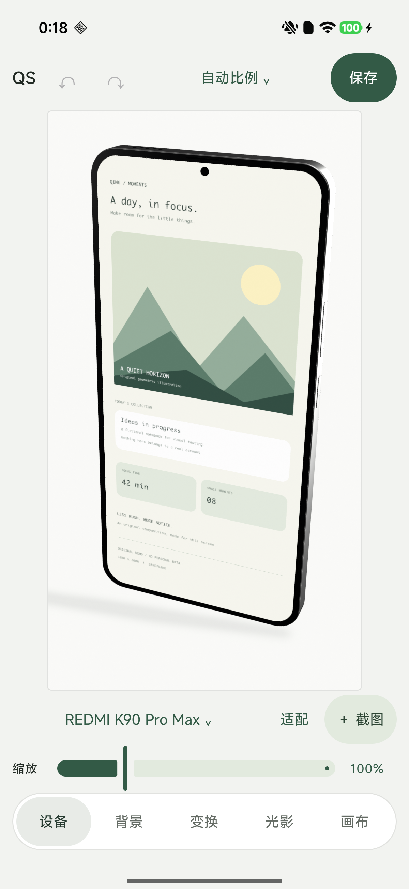
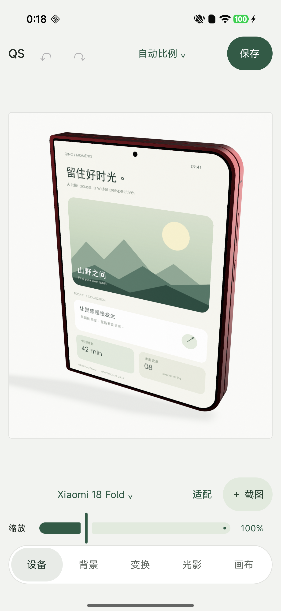

# Q-screenshot

在 Android 上离线制作真实 3D 手机套壳截图。导入图片，调整机型、配色、角度和光影，保存透明或带背景的 PNG；也可以从其他应用分享一张图片，按默认参数自动生成后继续分享。

**[下载最新版 APK](https://github.com/qing-yi-5427/Q-screenshot/releases/latest/download/Q-screenshot.apk)** · [版本说明与历史下载](https://github.com/qing-yi-5427/Q-screenshot/releases)

本地构建默认版本 **0.7.1**，发布版本以 [Releases](https://github.com/qing-yi-5427/Q-screenshot/releases) 为准。适用于 Android 10 及以上的 arm64 / x86_64 设备。当前提供 Debug 签名测试版，与此前安装的测试版可覆盖升级；也可按下方说明自行构建。

## 实机界面

<p>
  
  
</p>

两张均为 **Redmi K90 Pro Max / Android 16** 上通过系统 `screencap` 获取的原始应用屏幕，包含实际编辑器控件；屏内图片是原创离线示例。第二张展示的是在 Redmi 上编辑折叠机模型，并非另一台设备截图。详见[截图来源](docs/images/README.md)。

## 功能

- **真实三维模型**：直板主屏、折叠外屏与展开内屏；单指旋转，双指缩放、平移和扭转，支持撤销、重做及草稿恢复。前向旋转限制避免显示背面。
- **可见预览**：底部参数面板展开时，预览随剩余空间缩小；收起恢复大画布。横屏使用侧栏。
- **摄影棚光影**：PBR 机身材质、环境反射、灯光方向、玻璃弱反射与阴影；截图内容使用独立材质保持原色。
- **PNG 导出**：透明、纯色或渐变背景；2048 / 2560 / 3840 长边，支持 2160×3840、3840×2160 等画布输出。预览与导出共用渲染管线。
- **默认参数与外部分享**：保存渲染配置，自动处理其他应用分享来的单张图片，再打开系统分享面板。
- **本地处理**：无需账号，无水印；不申请网络或整库照片读取权限。通过系统图片选择器、文件选择器或临时 URI 授权读取用户选定图片。

### 机型与官方配色

| 机型 | 状态 | 配色 / 版本 |
|---|---|---|
| REDMI K90 Pro Max | 直板主屏 | 流金白、黑色、丹宁色、K90 Pro Max 冠军版（白色） |
| Xiaomi 18 Fold | 合拢外屏、展开内屏 | 暖金白、黑色、西野红、陶瓷特别版（淡粉外观） |

框体与背盖分别设置材质，换色不会给截图加滤镜。丹宁版采用独立厚度资源；陶瓷特别版与普通玻璃背盖区分材质。详细来源见[配色研究](docs/COLORWAYS_RESEARCH.md)。

## 使用

1. 点「＋ 截图」选择图片，在「设备」中选机型、状态和配色。
2. 调整角度、背景、光影与画布；「适配」会按当前机型重新构图。
3. 点顶部「保存」选择 PNG 长边并保存到 `Pictures/Q-screenshot`，随后可分享。

**保存默认参数：** 调好场景后，点底部「画布」面板顶部的「设为默认参数」。它保存机型、配色、姿态、灯光、背景、画布和导出尺寸等配置，不保存原图、URI 或图片尺寸。以后新工程与普通导入使用已保存默认；已有草稿仍恢复自己的设置。可随时再次保存更新默认。

**从其他应用自动套壳：** 在相册或其他应用中分享一张图片 → 选择「Q-screenshot · 图片套壳」→ 等待生成 PNG → 在系统分享面板自行选择接收应用。未设置默认时使用产品默认。此流程生成临时 PNG，不自动保存相册；返回后可再次分享。当前仅支持单张图片，不支持批量分享。

## 构建

要求 Android 10（API 29）及以上；打包 ABI 为 `arm64-v8a` 和 `x86_64`。

已验证的构建环境：JDK 21、Gradle Wrapper 9.8.0、AGP 9.4.1、Kotlin 2.4.20、Android SDK Platform 37、Build Tools 36.0.0。可在 Android Studio 中打开工程、选择 JDK 并配置 SDK；`local.properties` 使用自己的 SDK 位置。

```sh
./gradlew test :app:lintDebug :app:assembleDebug
```

生成 APK：`app/build/outputs/apk/debug/app-debug.apk`。Windows 使用 `gradlew.bat`。

可选的隔离输出构建，仅需 Python 标准库：

```sh
python3 tools/build_android.py --output Q-screenshot-debug.apk
```

普通构建使用仓库自带的 GLB、材质和 Filament AAR，不需要运行 Blender。完整依赖版本与来源见[工具链](docs/TOOLCHAIN.md)。如需运行 Android 测试，仅在授权设备或模拟器连接后执行 `./gradlew :app:connectedDebugAndroidTest`。

## 自动构建与发布

推送严格的 `vMAJOR.MINOR.PATCH` tag（例如 `v0.7.2`）后，GitHub Actions 构建 Debug 签名测试版，并发布固定附件 `Q-screenshot.apk` 与 `SHA256SUMS.txt`。上方「下载最新版 APK」无需随版本修改；重跑旧 tag 不会把最新版指回旧版本。tag 应指向已合并到默认分支、包含工作流的提交。

CI 的版本名来自 tag，版本码为 `major × 1000000 + minor × 1000 + patch`，如 `v0.7.2 → 7002`；同 tag 重跑不变。本地普通构建仍使用源码默认版本。也可在 Actions 手动运行 **Android APK**，输入版本，仅生成可下载 Artifact，不发布 Release。

维护者须配置仓库 Secret `QSCREENSHOT_DEBUG_KEYSTORE_BASE64`，复用现有测试签名；缺失或证书不一致时构建明确失败，不生成随机签名。该测试密钥不进入源码或附件。版本范围、签名与 Runner 依据见[发布说明](docs/RELEASING.md)。

## 技术与边界

Kotlin、Jetpack Compose / Material 3、Google Filament 1.79.0 / gltfio；GLB 模型由原创参数化工具生成，编辑状态驱动预览和离屏导出。系统分享使用独立接收 Activity、私有临时工程与 FileProvider 读取授权，避免覆盖当前编辑草稿。应用 ID 保持 `dev.qingframe`，便于旧版本覆盖升级保留数据。

模型参考官方尺寸、屏幕比例与公开多角度图重建，**不是原厂 CAD**。局部圆角、铰链曲率、PBR 色值与粗糙度为估计，未做实物色号或反射率测量。模型以正面截图为目标，背部结构简化；冠军版联名图案与特殊后摄细节不复刻。厂商照片、Logo 和壁纸未作为模型纹理打包。

0.7.0 的默认参数与外部分享流程已完成 31 项 Android 回归，并用不同 UID 的测试发送器和接收器验证实际 PNG 授权读取；0.7.1 仅更新公开名称与保存目录。实机界面与透明导出另经 Redmi 检查。尚未进行全面机型兼容、峰值性能、功耗或多图批量验证。

## 许可

原创代码与资源采用 [Apache License 2.0](LICENSE)，依赖许可见 [第三方声明](THIRD_PARTY_NOTICES.md)。本项目与 Xiaomi / REDMI 无隶属关系；相关品牌与产品设计权利属于各自权利人。
